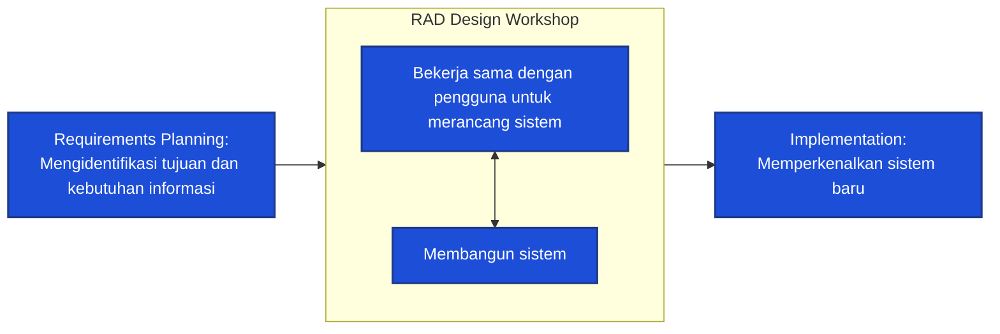

# Greenvision - Sistem Deteksi Penyakit Tanaman Kentang CV Anugrah Agro Putra

Greenvision adalah platform digital berbasis kecerdasan buatan (AI) yang dikembangkan khusus untuk mendukung **CV Anugrah Agro Putra (anugrahagroputra.id)** dalam mendeteksi dan mendiagnosis kesehatan daun tanaman kentang secara instan.

Dengan menggunakan teknologi **Convolutional Neural Network (CNN)**, sistem dapat memindai citra daun kentang dan mengklasifikasikannya ke dalam tiga kategori utama: *Healthy* (Sehat), *Early Blight* (Bercak Kering), atau *Late Blight* (Busuk Daun). Selain diagnosis, sistem juga memberikan rekomendasi solusi komprehensif berupa informasi penyebab, rekomendasi pestisida kimia/organik, pola penyiraman, dan langkah pencegahan preventif.

---

## 📂 Struktur Proyek (Directory Structure)

Proyek ini mengintegrasikan framework Laravel (PHP), Flask API (Python), MySQL, dan phpMyAdmin menggunakan Docker:

```text
Project v2/
├── README.md                   # Dokumentasi utama proyek
└── greenvision/
    ├── docker-compose.yml       # Konfigurasi orkestrasi multi-kontainer Docker
    ├── app/                     # Aplikasi Web Utama (Laravel 10, Tailwind CSS Play CDN, MySQL)
    │   ├── app/Http/Controllers # Controller utama (AuthController, DetectionController)
    │   ├── database/migrations  # Skema database (users, detections)
    │   └── resources/views      # Antarmuka Blade (rebranded hijau pertanian)
    └── python/                  # Layanan Kecerdasan Buatan (Flask API & Model CNN)
        ├── app.py               # Endpoint API Flask untuk inferensi gambar
        ├── model.h5             # Model saraf tiruan CNN yang sudah dilatih
        └── Dockerfile           # Instruksi build environment Flask API
```

---

## 🛠️ Spesifikasi Teknologi & Lingkungan (Docker Compose)

Sistem berjalan secara terisolasi di dalam 4 kontainer Docker berikut:

| Nama Layanan (Service) | Teknologi / Image | Port Eksternal | Peran & Deskripsi |
| :--- | :--- | :--- | :--- |
| **`laravel_backend`** | `bitnamilegacy/laravel:10` | `8000:8000` | Menyajikan antarmuka web, mengelola otentikasi user, riwayat diagnosis, dan mem-proxy permintaan gambar ke Flask API. |
| **`python_ai`** | Custom Python (Flask) | `8001:8001` | Melayani endpoint deteksi gambar daun kentang menggunakan library TensorFlow & OpenCV. |
| **`phpmyadmin`** | `phpmyadmin/phpmyadmin` | `8002:80` | Antarmuka grafis berbasis web untuk mengelola dan memantau database MySQL. |
| **`mysql_db`** | `mysql:8.0` | `8003:3306` | Menyimpan data user dan riwayat rekam medis diagnosis tanaman (`detections`). |

---

## 📊 Skema Database (`detections` table)

Setiap pengguna yang masuk log (login) dapat menyimpan riwayat deteksi secara otomatis ke tabel `detections`:

- `id` (Primary Key, Auto Increment)
- `user_id` (Foreign Key linked to `users`)
- `image_name` (Nama file gambar daun yang diunggah)
- `disease_name` (Hasil klasifikasi AI: `Potato___healthy`, `Potato___Early_blight`, atau `Potato___Late_blight`)
- `confidence` (Tingkat akurasi klasifikasi, tipe Float)
- `details` (Kolom tipe JSON yang menyimpan rekomendasi dinamis: penyebab, pestisida, penyiraman, pencegahan)
- `created_at` & `updated_at` (Timestamp rekam data)

## 📐 Metodologi Pengembangan RAD (Rapid Application Development)

Proyek ini dibangun menggunakan metode **Rapid Application Development (RAD)** untuk menjamin kecepatan siklus pengembangan yang disesuaikan secara berulang dengan kebutuhan pengguna.



1. **Requirements Planning**: Mengidentifikasi tujuan, cakupan sistem, dan kebutuhan informasi diagnosis tanaman kentang.
2. **RAD Design Workshop**: Proses iteratif perancangan antarmuka (Laravel Blade) dan pembangunan sistem (integrasi model CNN Flask) secara kolaboratif.
3. **Implementation**: Meluncurkan sistem ke lingkungan kontainer Docker lokal untuk digunakan secara langsung.

---

## 🔬 Spesifikasi Model AI (CNN)

- **Input Shape**: `(256, 256, 3)` (RGB)
- **Arsitektur**:
  - `Conv2D (32 filters, 3x3)` + `MaxPooling2D (2x2)`
  - `Conv2D (64 filters, 3x3)` + `MaxPooling2D (2x2)`
  - `Conv2D (64 filters, 3x3)` + `MaxPooling2D (2x2)`
  - `Flatten` -> `Dense (64 units, ReLU)` -> `Dense (3, Softmax Output)`
- **Endpoint Deteksi**: `POST http://python_ai:8001/predict` (menerima file citra berlabel key `file`).

---

## 🚀 Cara Menjalankan Aplikasi

Pastikan Docker & Docker Desktop telah terinstal di komputer Anda. Ikuti langkah mudah berikut:

### 1. Jalankan Orkestrasi Docker
Buka terminal Anda di direktori `Project v2` dan jalankan perintah:
```bash
docker compose -f greenvision/docker-compose.yml up -d
```

### 2. URL Akses Layanan
Setelah kontainer aktif, Anda dapat mengakses layanan melalui browser Anda pada alamat berikut:

- **Aplikasi Web Greenvision**: 👉 [http://localhost:8000](http://localhost:8000)
- **Flask AI API**: 👉 [http://localhost:8001](http://localhost:8001)
- **phpMyAdmin**: 👉 [http://localhost:8002](http://localhost:8002)
  - **Host**: `mysql_db`
  - **Username**: `root`
  - **Password**: `rootpass`

### 3. Matikan Kontainer
Untuk menghentikan semua kontainer:
```bash
docker compose -f greenvision/docker-compose.yml down
```

---

## 🍃 Rebranding & Desain
Antarmuka web Greenvision didesain menggunakan **Tailwind CSS** dengan menerapkan warna hijau pertanian daun khas (`#005024` & `#f3faf6`) yang disesuaikan dengan tema situs resmi **CV Anugrah Agro Putra**.
