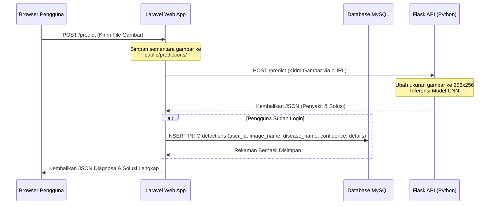

# Panduan Implementasi Aplikasi Web Laravel (app)

Dokumen ini menjelaskan struktur, alur kerja, integrasi database, dan konfigurasi sistem pada aplikasi web utama **Greenvision Anugrah Agro Putra** berbasis **Laravel 10**.

---

## 📂 Struktur Folder Aplikasi Laravel

```text
greenvision/app/
├── app/Http/Controllers/     # Controller Logika Aplikasi (AuthController, DetectionController)
├── app/Models/               # Eloquent Model (User, Detection)
├── database/migrations/      # Skema Database Relasional (users, detections)
├── config/                   # Berkas Konfigurasi Laravel
├── public/
│   └── predictions/          # Direktori penyimpanan unggahan citra daun kentang (chmod 777)
├── resources/views/          # Template View (Laravel Blade + Tailwind CSS Play CDN)
│   ├── layouts/app.blade.php # Layout Utama Rebranded Anugrah Agro Putra
│   ├── auth/                 # Login & Register Views
│   ├── home.blade.php        # Landing Page
│   ├── company-profile.blade.php # Profil Perusahaan & Produk Benih
│   ├── input.blade.php       # Form Deteksi Penyakit Daun Kentang (2-kolom)
│   ├── history.blade.php     # Riwayat diagnosis dengan statistik counts & hapus
│   └── detail.blade.php      # Laporan lengkap & cetak diagnosis tanaman
├── routes/web.php            # Deklarasi Seluruh Rute Aplikasi
└── .env                      # Kredensial lingkungan (database, API endpoint)
```

---

## 🔄 Alur Integrasi Laravel & API Flask (Python)

Ketika pengguna melakukan diagnosis gambar daun kentang di menu **Deteksi Penyakit**:



---

## 🛠️ Langkah Migrasi Database & Seeding

Jika Anda ingin melakukan migrasi database secara manual di luar kontainer Docker:

1. Salin berkas `.env.example` ke `.env` dan sesuaikan konfigurasi koneksi database:
   ```env
   DB_CONNECTION=mysql
   DB_HOST=127.0.0.1
   DB_PORT=3306
   DB_DATABASE=greenvision
   DB_USERNAME=greenuser
   DB_PASSWORD=rootpass
   ```
2. Jalankan perintah migrasi Laravel:
   ```bash
   php artisan migrate
   ```

---

## 🛡️ Hak Akses Folder Penyimpanan Gambar
Pastikan folder `public/predictions` memiliki hak akses tulis (writeable) agar Laravel dapat menyimpan gambar hasil unggahan pengguna:
```bash
chmod -R 777 public/predictions
```
